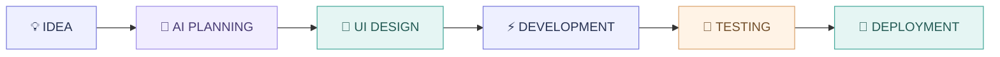

 

# Full-Stack Web Developer

### Designing interfaces. Engineering experiences. Exploring intelligent workflows.

 

 

---

<table width="100%">
<tr>
<td align="center" width="25%">

**01**

IDENTITY

**Developer**

</td>
<td align="center" width="25%">

**02**

SPECIALTY

**Frontend**

</td>
<td align="center" width="25%">

**03**

INNOVATION

**AI Workflows**

</td>
<td align="center" width="25%">

**04**

DIRECTION

**Full-Stack**

</td>
</tr>
</table>

## 01 — THE PERSON BEHIND THE CODE

<table width="100%">
<tr>
<td width="65%" valign="top">

### Hello, I'm Darshan.

I'm a web developer and Integrated MCA student based in Ahmedabad, India.

I enjoy transforming concepts into polished digital products through modern frontend engineering, thoughtful design and AI-assisted development.

My interests extend beyond writing components. I enjoy understanding product requirements, exploring visual directions, structuring applications, implementing features and refining the complete user experience.

**What drives me**

- Building meaningful digital experiences.
- Exploring modern web technologies.
- Creating premium, responsive interfaces.
- Using AI tools intelligently throughout development.
- Continuously improving my engineering fundamentals.

</td>
<td width="35%" valign="top" align="center">

  

**CURRENT FOCUS**

React Engineering

AI-assisted workflows

MERN Stack Learning

Product Development

</td>
</tr>
</table>

---

## 02 — ENGINEERING TOOLKIT

TECHNOLOGIES / FRAMEWORKS / TOOLS

<table width="100%" border="1" cellpadding="12">
<tr>
<td width="50%" valign="top">

### 🎨 FRONTEND ENGINEERING

**Core areas**

- HTML5 & CSS3
- JavaScript
- React.js & React Hooks
- React Router
- Responsive UI development
- Tailwind CSS & Bootstrap
- Framer Motion

</td>
<td width="50%" valign="top">

### ⚙️ BACKEND DEVELOPMENT

**Currently learning**

- Node.js
- Express.js
- MongoDB
- REST API development
- CRUD operations
- Authentication fundamentals
- Full-stack integration

</td>
</tr>
<tr>
<td valign="top">

### 🤖 AI & CREATIVE TECHNOLOGY

**Exploring**

- AI-assisted coding
- Prompt architecture
- UI concept generation
- Code analysis and debugging
- Agentic development workflows

</td>
<td valign="top">

### 🛠️ DEVELOPMENT TOOLS

**Additional experience**

- Git & GitHub
- Vite
- Axios
- REST APIs
- LocalStorage
- Recharts
- Chrome DevTools

</td>
</tr>
</table>

---

## 03 — AI-AUGMENTED ENGINEERING STUDIO

HOW I TURN IDEAS INTO WORKING PRODUCTS

<table width="100%" border="1" cellpadding="12">
<tr>
<td align="center" width="33%">

### 01

**THINK**

Requirements, product discovery, user stories and technical planning.

</td>
<td align="center" width="33%">

### 02

**DESIGN**

Stitch exploration, visual systems, typography and component planning.

</td>
<td align="center" width="33%">

### 03

**BUILD**

Antigravity-assisted implementation, React components and application logic.

</td>
</tr>
<tr>
<td align="center">

### 04

**REFINE**

Code understanding, debugging, validation and responsive improvements.

</td>
<td align="center">

### 05

**TEST**

Functional flows, edge cases, integration and usability checks.

</td>
<td align="center">

### 06

**SHIP**

Deployment, documentation and continuous iteration.

</td>
</tr>
</table>

> AI accelerates my workflow. Engineering fundamentals, code understanding and testing remain essential parts of my process.

---

## 04 — SELECTED DIGITAL PRODUCTS

PROJECTS / EXPERIMENTS / REAL-WORLD APPLICATION CONCEPTS

<table width="100%" border="1" cellpadding="14">
<tr>
<td colspan="2">

### 🚜 PROJECT 01 — VEHIK

**Commercial Vehicle & Heavy Equipment Marketplace**

An interactive marketplace concept designed to make commercial equipment discovery and provider exploration easier.

- Dynamic equipment catalog and filtering.
- Responsive marketplace interface.
- Inquiry and discovery workflows.
- Browser-based persistence.

**TECHNOLOGY**

`React.js` `Vite` `Tailwind CSS` `LocalStorage`

[↗ LIVE EXPERIENCE](https://vehik-heavy-equipment-marketplace.vercel.app/) · [↗ SOURCE CODE](https://github.com/Bdarshan3007/vehik-heavy-equipment-marketplace)

</td>
</tr>
<tr>
<td colspan="2">

### ☕ PROJECT 02 — CAFEFLOW

**Digital Café Management Platform**

A café operating experience connecting digital ordering, table management and kitchen workflows.

- QR-based table ordering.
- Digital menu and product customization.
- Cart and GST billing.
- Kitchen order management.
- Order tracking and role-based workflows.

**TECHNOLOGY**

`React.js` `Vite` `Tailwind CSS` `Framer Motion` `LocalStorage`

[↗ LIVE EXPERIENCE](https://cafe-flow-five.vercel.app) · [↗ SOURCE CODE](https://github.com/Bdarshan3007/cafeFlow)

</td>
</tr>
<tr>
<td colspan="2">

### 🎬 PROJECT 03 — DFLIX

**Movie Discovery & Review Application**

A movie discovery platform powered by the OMDb API.

- Real-time movie search.
- Detailed movie information and cast.
- User ratings and reviews.
- Browser-based review persistence.

**TECHNOLOGY**

`React.js` `Vite` `React Router` `OMDb API` `Bootstrap`

[↗ LIVE EXPERIENCE](https://dk-rjs-dflix.vercel.app) · [↗ SOURCE CODE](https://github.com/Bdarshan3007/DFlix)

</td>
</tr>
<tr>
<td width="50%" valign="top">

### 🌤️ PROJECT 04 — SKYCAST

**Weather Dashboard**

- Weather information and forecasts.
- Open-Meteo integration.
- Responsive dashboard.
- Weather-based visual experiences.

`React` `Open-Meteo API` `CSS`

[Live ↗](https://dk-rjs-skycast.vercel.app) · [Code ↗](https://github.com/Bdarshan3007/SkyCast)

</td>
<td width="50%" valign="top">

### 🔐 PROJECT 05 — DYNAMIC FORM

**Form & Validation Application**

- Formik form management.
- Yup validation schemas.
- Input validation.
- Browser-based state persistence.

`React` `Formik` `Yup`

[Live ↗](https://dk-rjs-dynamicform.vercel.app) · [Code ↗](https://github.com/Bdarshan3007/Dynamic_Form)

</td>
</tr>
<tr>
<td width="50%" valign="top">

### 🏎️ PROJECT 06 — SUPERCAR-ANTI

**Luxury Automotive Showcase**

- Premium automotive interface.
- Vehicle-focused presentation.
- Responsive layouts.
- Interactive visual elements.

`React` `Vite` `CSS`

[Live ↗](https://super-car-sigma.vercel.app) · [Code ↗](https://github.com/Bdarshan3007/SuperCar-Anti)

</td>
<td width="50%" valign="top">

### 🍽️ PROJECT 07 — DARSHAN'S DINE

**Restaurant Website**

- Interactive restaurant experience.
- Menu categorization.
- Cart and checkout interface.
- Responsive layouts.

`HTML` `CSS` `JavaScript`

[Live ↗](https://darshan-s-dine.vercel.app) · [Code ↗](https://github.com/Bdarshan3007/Darshan-s-Dine)

</td>
</tr>
<tr>
<td width="50%" valign="top">

### ✅ PROJECT 08 — TODO ENGINE

**Task Management Application**

- Task management interface.
- React Router.
- Browser persistence.
- Reusable components.

`React` `Vite` `React Router`

[Live ↗](https://dk-rjs-todo-app.vercel.app) · [Code ↗](https://github.com/Bdarshan3007/Todo_app)

</td>
<td width="50%" valign="top">

### 📊 PROJECT 09 — SMART ATTENDANCE

**Hackathon Team Project**

- Attendance management interface.
- Student management.
- Dashboard analytics.
- Reporting and visualizations.

`React` `Tailwind CSS` `Recharts`

Four-member hackathon project. See resume for contribution details.

</td>
</tr>
</table>

---

## 05 — LEARNING LAB

THE NEXT CHAPTER OF MY DEVELOPMENT JOURNEY

<table width="100%" border="1" cellpadding="12">
<tr>
<td width="50%">

### Backend Engineering

- Node.js
- Express.js
- REST APIs
- MongoDB
- CRUD operations
- Authentication

</td>
<td width="50%">

### Full-Stack Engineering

- Frontend/backend integration
- Database modelling
- Server-side validation
- Application security
- Complete MERN applications

</td>
</tr>
</table>

**My current direction:** Build a strong foundation in backend development and progress towards developing complete full-stack applications independently.

---

## 06 — GITHUB INSIGHTS

MY OPEN-SOURCE DEVELOPMENT ACTIVITY

<a href="https://github.com/Bdarshan3007">

  

</a>

### Contribution Journey

---

## 07 — EDUCATION & ACHIEVEMENTS

<table width="100%" border="1" cellpadding="14">
<tr>
<td width="65%" valign="top">

### 🎓 EDUCATION

**Integrated Master of Computer Applications**

LJ University of Computer Applications, Ahmedabad

`2025 – 2031`

**CGPA: 8.7**

</td>
<td width="35%" align="center" valign="middle">

ACADEMIC FOUNDATIONS

</td>
</tr>
<tr>
<td colspan="2">

### 🏆 CERTIFICATIONS & ACHIEVEMENTS

- Coursera — Interactivity with JavaScript.
- Coursera — Introduction to HTML, CSS & JavaScript.
- Hackathon participant — Smart Attendance Management System.

</td>
</tr>
</table>

---

## 08 — LET'S CONNECT

### GOOD IDEAS START WITH A CONVERSATION.

Interested in web development, creative technology, AI-assisted workflows or collaboration? Let's connect.

 

  

**DESIGN WITH INTENTION · BUILD WITH UNDERSTANDING · EVOLVE WITH AI**

*An evolving developer journey by Darshan Bhadada.*

